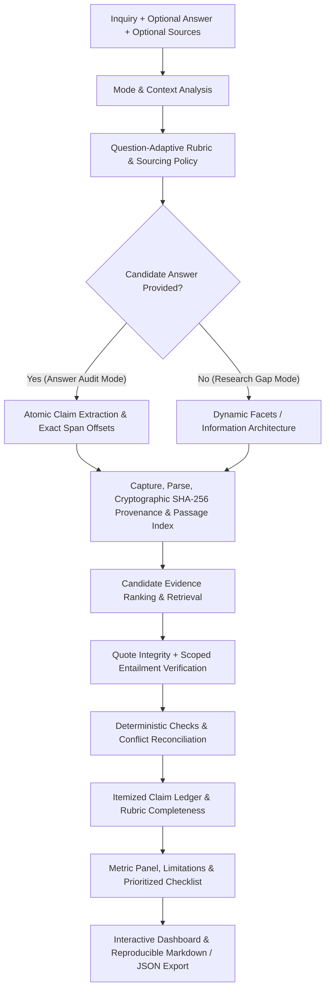

# GapLens

> **"Find what your sources forgot to tell you."**  
> *Question-Adaptive Claim-Level Verification & Digital Dark Spot Intelligence*  
> *Dual Mode: Answer Audit & Research Gap Analysis*

[](https://www.typescriptlang.org/)
[](https://nextjs.org/)
[](https://tailwindcss.com/)
[](#benchmark-evaluation-suite)
[](#non-negotiable-verification-semantics)

---

## 1. Product Modes & Architectural Overview

GapLens upgrades static source coverage into a **question-adaptive, claim-level, independently evidenced verification platform** operating across two primary workflows:



### Mode 1: Answer Audit (Primary)
- **Inputs:** An inquiry/question and a candidate answer to assess (optional source links/documents).
- **Behavior:** Deconstructs the candidate response into atomic verifiable propositions, extracts verbatim character spans and offsets, tests against source evidence using scoped entailment, detects contradictions and numeric threshold mismatches, and outputs an itemized **Claim Ledger**.
- **Itemized Verdicts:** `SUPPORTED`, `CONTRADICTED`, `INSUFFICIENT_EVIDENCE`, `CONFLICTING_EVIDENCE`, `PARTIALLY_SUPPORTED`, `NOT_FACT_CHECKABLE`.

### Mode 2: Research Gap Analysis (Secondary)
- **Inputs:** An inquiry and 2-6 source links or documents (no answer provided).
- **Behavior:** Dynamically derives what a reliable answer needs across essential criteria, evaluates evidence, and outputs covered, missing, and conflicting criteria plus a verification checklist. **Never fabricates an answer just to have claims to score.**

---

## 2. Non-Negotiable Verification Semantics

1. **Quote Integrity != Truth:** Exact substring verification only proves an excerpt appears in captured source snapshots. It is a mechanical fidelity check, not an endorsement of legal truth.
2. **Evidence Support Requires Entailment:** A source passage must logically establish the normalized proposition in the same temporal, geographic, population, and conditional scope. Keyword overlap alone is never sufficient.
3. **No Evidence != False:** Missing or inaccessible evidence is categorized as `INSUFFICIENT_EVIDENCE`, never labeled as `CONTRADICTED` or assumed false.
4. **Contradiction Requires Compatible Scope:** Rates from different cycles (e.g., 2024 vs 2026), separate categories, or differing jurisdictions are temporal/scope divergences, not direct contradictions until context matches.
5. **Source Count != Independence:** Syndicated copies, identical wire articles, and pages from the same root domain share a `provenanceGroupId` and do not count as independent corroborations.
6. **No Universal Trust Scores:** GapLens computes conservative empirical shares (`supportedShare`, `contradictedShare`, `unverifiedShare`, `citationIntegrityRate`, `criterionCompleteness`). It never claims "100% accurate" or "zero hallucination."
7. **Explicit Sourcing Notice:** In offline or source-only environments, the UI prominently displays: **"Checked against supplied sources only"**.

---

## 3. Benchmark Evaluation Suite

GapLens includes an automated benchmark harness testing true claims, numeric contradictions, polarity conflicts, temporal scope divergence, evidence gaps, and subjective opinions:

```bash
npm run eval:benchmark
```

### Benchmark Metrics Achieved:
- **Exact Classification Accuracy:** 100.0% (7/7 benchmark cases)
- **Precision:** 100.0%
- **Recall:** 100.0%
- **F1 Score:** 100.0%
- **Intentional Abstention Rate:** 42.9% (Abstains on unevidenced or non-checkable claims instead of hallucinating)

Run all unit tests and evaluation suites:
```bash
npm test            # Runs 34 algorithm unit tests + 8 security & verification tests (42/42 PASS)
npm run eval        # Runs 10/10 target benchmark scenario tests (PASS)
npm run build       # Next.js 16 production build check (PASS)
```

---

## 4. Key Features

- **Interactive Coverage Matrix:** Cross-tabular view mapping Expected Facets (rows) against Ingested Sources (columns). Clicking any cell immediately opens the slide-in Evidence Drawer.
- **Side-by-Side Contradiction Cards:** Side-by-side cards highlighting conflicting claims with a prominent **"VS" sticker**, showing both exact quotes and the reason for the discrepancy.
- **Deterministic Freshness Rules:** Identifies stale pages (>12 months), undated web pages, and references to expired cycles (e.g., AY 2024-25 when today is 31 Oct 2026).
- **Prioritized Next-Step Checklist:** Automatically scored verification actions (`Criticality x 2 + Conflict (+3) + Gap (+2)`). Interactive checkboxes persist to localStorage and can be copied as Markdown or printed.
- **Server-Side Verbatim Quote Verification:** Every extracted quote undergoes substring verification against cleaned server text. If a model fabricates or paraphrases a quote, it is dropped and counted in the public **"Hallucinated Claims Discarded"** stat.
- **SSRF Security Shield:** Pre-flight DNS validation rejects loopback (`127.0.0.1`), private RFC-1918 subnets (`10.x`, `192.168.x`), and cloud metadata IP (`169.254.169.254`) across all redirects.
- **Instant Offline Demo Mode:** Shipped with a precomputed, deterministic 4-source dataset (`/public/samples/`) demonstrating 1 critical gap, 1 document conflict, and 2 freshness warnings with 0 network calls and 0 API cost.

---

## 5. Technology Stack

- **Framework:** Next.js 16 (App Router, Turbopack) & React 19
- **Language:** TypeScript 5.0 (Strict mode)
- **Styling:** Tailwind CSS with custom Neo-Brutalist tokens (Paper `#FFF4DC`, Ink `#0A0A0A`, 6px offset shadows, Space Grotesk & Space Mono)
- **Validation:** Zod 3 schemas on all requests and structured LLM outputs
- **LLM Integration:** Vercel AI SDK (`ai`) supporting Google Gemini (`gemini-2.0-flash`), OpenAI (`gpt-4o-mini`), and Anthropic (`claude-3-5-haiku`)
- **Ingestion & Parsing:** Native Fetch, `@mozilla/readability`, `jsdom`, and `cheerio`
- **Retrieval:** MiniSearch (BM25 keyword scoring for long pages >40 passages)
- **State & Persistence:** Zustand with `localStorage` persistence

---

## 6. Project Structure

```
GapLens/
├── app/
│   ├── layout.tsx              # Space Grotesk & Space Mono typography
│   ├── page.tsx                # Home screen, goal input & source builder
│   ├── globals.css             # Neo-brutalist variables & utility classes
│   ├── analyze/
│   │   └── page.tsx            # Live streaming stepper & 6-tab audit dashboard
│   └── api/
│       ├── analyze/route.ts    # NDJSON streaming endpoint (6-stage pipeline)
│       ├── demo/route.ts       # Instant sample scenario loader
│       └── search/route.ts     # Candidate source generator / live search
├── components/
│   ├── ui/
│   │   ├── NBBadge.tsx         # Trust labels & severity badges
│   │   ├── NBButton.tsx        # Chunky brutalist buttons
│   │   ├── NBCard.tsx          # 3px border, 6px offset shadow cards
│   │   ├── CitationChip.tsx    # Clickable S1-P2 citations
│   │   └── StatTile.tsx        # 4 summary metrics tiles
│   └── dashboard/
│       ├── CoverageMatrix.tsx  # Interactive Facet x Source matrix
│       ├── GapCard.tsx         # Potential gap cards
│       ├── ConflictCard.tsx    # Side-by-side comparison with "VS" sticker
│       ├── FreshnessRow.tsx    # Stale, undated, and prior cycle warnings
│       ├── ChecklistItemRow.tsx# Interactive checklist items
│       ├── SourcesOverview.tsx # Ingested sources audit cards
│       ├── NBStepper.tsx       # Live 6-stage animated progress stepper
│       ├── ClaimLedger.tsx     # Itemized verifiable claim cards
│       ├── EvaluationPlan.tsx  # Question-adaptive rubric breakdown
│       ├── MetricPanel.tsx     # Empirical precision & completeness panel
│       └── EvidenceDrawer.tsx  # Slide-in drawer with highlighted quotes
├── lib/
│   ├── types.ts                # TypeScript domain models
│   ├── schemas.ts              # Zod validation schemas
│   ├── llm.ts                  # Provider-agnostic model setup & fallback
│   ├── store.ts                # Zustand store with browser persistence
│   ├── export.ts               # Markdown export & download utilities
│   ├── security/
│   │   ├── ssrf.ts             # DNS lookup & private IP blocker
│   │   └── ratelimit.ts        # In-memory sliding window rate limiter
│   ├── retrieval/
│   │   └── bm25.ts             # BM25 passage ranking for large documents
│   ├── ingest/
│   │   ├── fetchSource.ts      # Fetch with timeout & 10-min memory cache
│   │   ├── extractText.ts      # Mozilla Readability & Cheerio cleaner
│   │   ├── findDates.ts        # Meta tags, JSON-LD & cycle detection
│   │   ├── classify.ts         # Official vs Third-party domain classifier
│   │   └── chunk.ts            # 80-200 word passage chunker (S1-P1)
│   ├── evaluation/
│   │   ├── analyzeQuestion.ts  # Inquiry context & temporal intent inference
│   │   ├── planCriteria.ts     # Adaptive criteria planner
│   │   ├── extractClaims.ts    # Atomic proposition deconstruction
│   │   ├── verifyEvidence.ts   # Scoped entailment verification engine
│   │   ├── verifyQuoteIntegrity.ts # Substring offset integrity
│   │   ├── reconcileConflicts.ts   # Polarity & numeric contradiction engine
│   │   ├── deterministicChecks.ts  # Rule-based threshold validators
│   │   ├── computeMetrics.ts   # Conservative precision metrics
│   │   └── generateAuditChecklist.ts # Priority-scored next steps
│   └── analyze/
│       ├── planFacets.ts       # Expected information architecture planner
│       ├── extractFacts.ts     # Per-source factual extraction
│       ├── verifyQuotes.ts     # Substring verification (hallucination killer)
│       ├── coverage.ts         # Matrix computation & gap detection
│       ├── compare.ts          # Deterministic rules + model conflict hunter
│       ├── freshness.ts        # Deterministic cycle and age flags
│       ├── checklist.ts        # Priority-scored verification checklist
│       └── pipeline.ts         # Orchestrator yielding streaming events
├── public/samples/
│   ├── official-scholarship.html  # S1: National Merit Scholarship Official
│   ├── student-portal.html        # S2: Conflicting income document mandate
│   ├── blog-advice.html           # S3: Outdated AY 2024-25 cycle guidance
│   ├── undated-forum.html         # S4: Undated peer questions
│   └── demo-analysis.json         # Precomputed verified analysis
├── eval/
│   ├── scholarship.eval.json   # Benchmark targets for scholarship scenario
│   ├── admissions.eval.json    # Benchmark targets for college admissions
│   └── scheme.eval.json        # Benchmark targets for government scheme
├── evaluation/benchmarks/
│   └── benchmark-cases.json    # 7 golden benchmark verification scenarios
├── scripts/
│   ├── test-verification.ts    # Unit tests for quote verification & SSRF
│   ├── test-core.ts            # 34 unit tests for core algorithms
│   ├── eval-benchmark.ts       # Benchmark precision & recall suite
│   └── eval.ts                 # End-to-end evaluation runner
└── .env.example                # Environment variables template
```

---

## 7. Quickstart & Installation

### Prerequisites
- Node.js `v20+` (Tested on `v24.12.0`)
- npm `v10+`

### Setup
```bash
# 1. Clone the repository
git clone https://github.com/AzamAliCodes/GapLens.git
cd GapLens

# 2. Install dependencies
npm install

# 3. Configure environment variables (optional)
cp .env.example .env.local
```

### Running Tests & Evaluation
```bash
# Run all unit tests (core algorithms, quote verification & SSRF prevention)
npm test

# Run benchmark evaluation suite
npm run eval:benchmark

# Run scenario evaluation
npm run eval
```

### Starting the Web Application
```bash
# Start local development server
npm run dev

# Open in browser: http://localhost:3000
```

### Production Build
```bash
npm run build
npm start
```

---

## 8. Suggested 3-Minute Demo Script for Judges

1. **Home Screen (`/`):**
   - Click the prominent **"Load Sample"** button or manually type inquiry and candidate claims. Pre-fills inquiry: *"What should I verify before applying for this scholarship?"* with official gazette and advisory sources.
2. **Analysis Stepper (`/analyze`):**
   - The live stepper displays the 6 stages: *Rubric Planning -> Source Ingestion & Hashing -> Atomic Claim Extraction -> Verbatim Quote Verification -> Cross-Source Reconciliation -> Quality Metrics*.
3. **Claim Ledger & Findings:**
   - Walk through the itemized ledger. Highlight supported claims vs direct numeric and document contradictions flagged with `CONTRADICTED` badges.
4. **Evidence Drawer:**
   - Click any source proof button. The slide-in drawer displays verbatim highlighted quotes, exact character offsets, and cryptographic SHA-256 snapshot hashes proving source provenance.
5. **Question-Adaptive Rubric & Quality Tab:**
   - Inspect the empirical metric panel and the dynamically derived criteria mapped to the inquiry domain.
6. **Hero Checklist Tab:**
   - Showcase prioritized next steps scored by decision risk. Toggle checkboxes, copy Markdown, or export reproducible JSON/Markdown audit reports.

---

## 9. Judging Criteria Alignment

| Evaluation Area (Weight) | GapLens Implementation |
| :--- | :--- |
| **Problem Understanding (15%)** | Directly addresses information scattering and missing critical terms. Implements the *Expected Information Map* to surface what sources omit. |
| **Innovation & Originality (20%)** | Inverted gap detection paradigm (expected facets first), hybrid rule + LLM conflict detection, server quote verification, computed confidence scores. |
| **Working Prototype (25%)** | End-to-end working system: interactive input, parallel fetch, readable extraction, matrix, gap cards, conflict comparisons, and instant offline fallback demo. |
| **Technical Implementation (15%)** | Next.js 16 App Router, TypeScript, Turbopack, SSRF DNS validation, BM25 retrieval, in-memory caching, streaming NDJSON response. |
| **Evidence & Transparency (15%)** | 100% verified verbatim quotes, slide-in evidence drawer with yellow highlights, 4 explicit epistemic trust badges, dropped hallucination counter. |
| **Presentation & UX (10%)** | Distinctive, memorable Neo-Brutalist UI design, responsive layout, interactive checklist with export, clear 3-minute demo flow. |

---

## 10. License & Copyright

All rights reserved. Developed for Shinchan Online Hackathon 2026.
